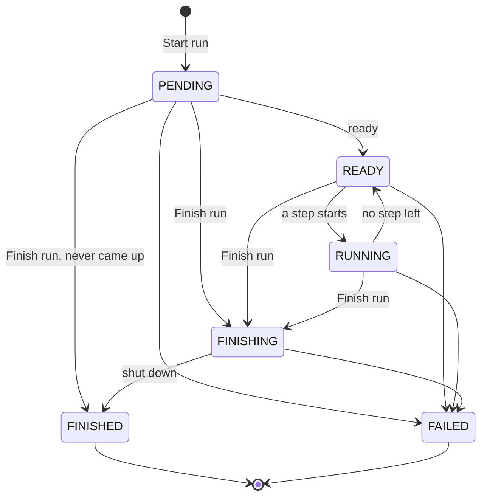

# Run lifecycle

A Harmonise run goes through a fixed set of states, from when you start it to when it is over. The run page shows the current one as its **Status**, with the times it was **Created**, **Ready** and **Finished**. This page explains each state so that you can tell what a run is doing and why it ended as it did.

For what a run is, see [About Harmonise](about-harmonise.md).

## States

| State | Meaning |
|---|---|
| `PENDING` | The run has started, and its processing environment is being set up. It cannot take steps yet. |
| `READY` | The run is waiting for your next step. |
| `RUNNING` | The run is taking a step. Steps you ask for meanwhile wait for their turn. |
| `FINISHING` | You finished the run. It completes the step in progress, then shuts down. |
| `FINISHED` | The run shut down after you finished it. Final. |
| `FAILED` | The run ended before it could shut down cleanly. Final. |

For a normal run the order is `PENDING` → `READY` → `RUNNING` → `READY` → … → `FINISHING` → `FINISHED`.

## Starting: PENDING

A new run is `PENDING` while ODM sets up its processing environment and until the run reports that it is ready. Steps are refused until then. While the run waits, its status says why, for example `Unschedulable` for a moment while its storage is set up, then `ContainerCreating` while the environment starts. A run that stays `PENDING` with a reason such as `ErrImagePull` or `Unschedulable` cannot start: finish it, and let your administrator know.

## Working: READY and RUNNING

Once ready, the run is `READY`. It takes the steps you ask for one at a time, in the order you asked for them, and is `RUNNING` while it takes one. A step you ask for while another is in progress waits for its turn. Each step is listed on the run page with its own status:

| Step status | Meaning |
|---|---|
| `PENDING` | The step waits for its turn. |
| `RUNNING` | The run is taking the step. |
| `SUCCEEDED` | The step completed. |
| `FAILED` | The step did not complete; the run page shows why. |
| `SKIPPED` | The step never ran, because the run was finished, or failed, before its turn. |

A step that fails does not end the run: the run goes on to the next step, or waits for one.

Each run has storage of its own for the files it works on, of a size your administrator sets, and it is deleted once the run is over. A step that runs out of that storage fails with an error that starts `No space left` and says how much the run has. If your steps need more, let your administrator know.

## Finishing: FINISHING and FINISHED

Finishing is the only way to end a run; there is no cancel. When you finish a run, it becomes `FINISHING`: the step in progress runs to its end, the steps that have not started are `SKIPPED`, and the run shuts down, which the run page lists as its last step, `shutdown`. Once its processing environment has stopped and been removed, the run is `FINISHED`. Finishing a run again, or a run that is over, changes nothing.

A run you finish while it is still `PENDING` shuts down as soon as it is ready. If its processing environment never came up, there is nothing to shut down: the run is `FINISHED` at once, with the reason `Finished before its Pod was ready`.

## Failure: FAILED

A run is `FAILED` when it ends before it can shut down cleanly:

- its processing environment stopped unexpectedly;
- it reached its time limit;
- its shutdown failed;
- ODM was restarted while the run was open. The reason is then `applications restarted while the run was open`.

A failed run keeps its record, with the steps it took and their results. Steps it had not started are `SKIPPED`.

## Time limit

A run is bounded in time, from when its processing environment starts: one hour, unless your administrator set another limit. The limit covers the whole run, including a step that never ends: a run still open when it is reached is `FAILED`. Finish a run once you are done with it.

## Related

- [About Harmonise](about-harmonise.md), what a run is.
- [Start and finish a run](start-and-finish-a-run.md), the steps to start a run and to finish it.
- [Harmonisation API reference](../../odm-api/contribute/harmonise/harmonisation-api-reference.md), the same states as the API returns them.
